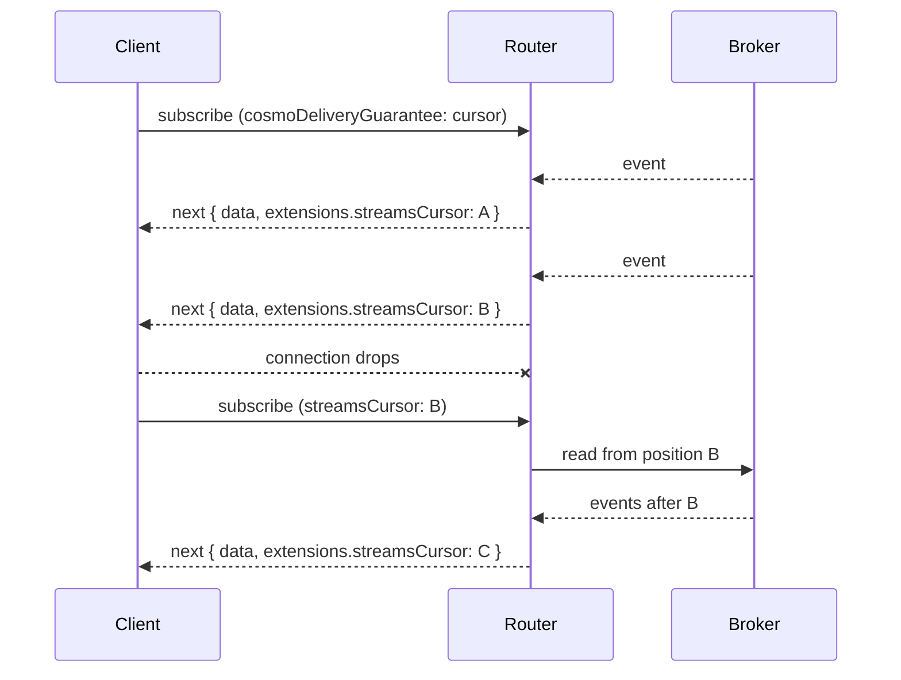

<Warning>
  Cursors are an **experimental** feature. Do not use in production. The schema arguments, router configuration and request/response formats may change in future releases without notice.
</Warning>
<Note>
Currently only [Kafka](/router/cosmo-streams/kafka) subscriptions support cursors.
</Note>

## What are Cursors?

### The problem

By default, Cosmo Streams subscriptions deliver events **at most once**. The Router receives an event from the broker, resolves it for every subscribed client and pushes it onto the client's WebSocket or SSE connection, fire-and-forget. This has consequences:

- A client that disconnects and later reconnects misses every event that arrived in between.
- A Router that restarts starts reading at the head of the topic and misses events that arrived while it was down.
- The client has no way to find out what it missed or how to recover it.

### How Cursors solve it

A **cursor** is an opaque token that describes where in the broker the event of a message is positioned. A client that opts in receives one cursor as part of every message.
In case a client loses connection for any reason it can provide the cursor of its last received message back to the router when reconnecting.
The Router then reads the topic from that position and replays everything the client hasn't seen yet, before continuing with live events.



Key properties:

- **Opt-in on both sides.** The schema declares which subscription fields support cursors, and each client decides per subscription whether it wants them. Existing schemas, routers and clients are unaffected.
- **Stateless Router.** The Router doesn't store any per-client state. The client remembers its position, the broker remembers the events. Resuming works against any Router instance, so it works behind a load balancer and across Router restarts.
- **Works over WebSockets and SSE.** The cursor travels in the GraphQL `extensions` of each message.
- **Tamper-proof and user-bound.** Cursors are signed by the Router and bound to user that received them, if they use JWT's. A client can't modify a cursor, and another user can't use it.
- **Replayed events are resolved again.** A resumed subscription resolves each replayed event like a fresh one, including authorization.
- **Library Agnostic.** Transfering and negotiating cursors is done via `extensions` metadata and is supported by every library. 

### What cursors are good for

- Mobile or browser clients on unreliable networks that must not lose events when the connection flaps.
- Clients that deploy or restart and need to continue where they stopped.
- Rolling restarts of Routers without event loss for connected clients.

### Limitations

- **At-least-once, not exactly-once.** A client may receive an event again if it resumes from an earlier cursor than the last event it processed. Make processing idempotent or deduplicate on your own identifier.
- **The broker must still hold the events.** If the broker's retention has dropped them, they can't be replayed. The Router does not store events itself.
- **Only events with a broker position carry a cursor.** Events created by [Custom Module](/router/cosmo-streams/custom-modules) hooks and events emitted from `SubscriptionOnStart` are sent without one.
- **Kafka only.** NATS and Redis don't support cursors at the moment.
- **Cosmo Streams only.** Plain subscriptions are not supported at the moment.


## Set up Cursors in Router

Enabling cursors takes two steps: declare the supported Cosmo Streams subscriptions in your schema and configure signing keys in the Router.

### 1. Schema

Add the optional `deliveryGuarantees` argument to the `@edfs__kafkaSubscribe` directive, together with the `edfs__DeliveryGuarantees` input and the `edfs__DeliveryGuaranteeMode` enum. Setting `mode: CURSOR` makes the field offer cursors to clients that ask for them.

```graphql
directive @edfs__kafkaSubscribe(
  topics: [String!]!
  providerId: String! = "default"
  deliveryGuarantees: edfs__DeliveryGuarantees
) on FIELD_DEFINITION

enum edfs__DeliveryGuaranteeMode {
  OFF
  CURSOR
}

input edfs__DeliveryGuarantees {
  mode: edfs__DeliveryGuaranteeMode! = OFF
}

type Subscription {
  employeeUpdatedMyKafka(employeeID: Int!): Employee!
    @edfs__kafkaSubscribe(
      topics: ["employeeUpdated", "employeeUpdatedTwo"]
      providerId: "my-kafka"
      deliveryGuarantees: { mode: CURSOR }
    )
}
```

Fields without `deliveryGuarantees` (or with `mode: OFF`) keep the default at-most-once behavior. The argument is backwards compatible, existing schemas and Routers keep working unchanged. Routers that don't know the argument ignore it.

Publish the updated schema as usual:

```bash
wgc subgraph publish edg --namespace default --schema edg.graphqls
```

### 2. Router configuration

Cursors are signed, so the Router needs at least one secret. Configure it under `events.delivery_guarantees.cursor_resume`:

```yaml config.yaml
events:
  providers:
    kafka:
      - id: my-kafka
        brokers:
          - "localhost:9092"
  delivery_guarantees:
    cursor_resume:
      identity_claim: sub
      max_resume_window: 3h
      keys:
        - id: 1
          secret: "${COSMO_CURSOR_KEY_1}"
```

<Note>
  If a field declares `mode: CURSOR` but no `keys` are configured, the Router can't issue cursors. A client that asks for them is rejected with `DELIVERY_GUARANTEE_UNSATISFIABLE`.
</Note>

#### Options

| Option | Default | Description |
| ------ | ------- | ----------- |
| `identity_claim` | `sub` | The claim of the authenticated request JWT that cursors are bound to. A cursor can only be resumed by a client with the same authenticator, issuer, audience and identity claim value. An authenticated request without this claim can't use cursors and fails with `DELIVERY_GUARANTEE_UNSATISFIABLE`. |
| `max_resume_window` | `3h` | How long after it was issued a cursor can still be resumed. Older cursors are rejected with `CURSOR_EXPIRED`. Specify as a duration, e.g. `30m` or `6h`. |
| `keys` | none | The keyring cursors are signed with. See below. |

Each entry of `keys` has these fields:

| Field | Required | Description |
| ----- | -------- | ----------- |
| `id` | yes | Integer from 0 to 255, unique within the keyring. |
| `secret` | yes | The secret the signing key is derived from, at least 32 bytes. |
| `expires_at` | no | RFC 3339 timestamp after which the key stops **signing** new cursors. The key keeps verifying cursors for as long as it is configured. |

#### Signing keys

- **Share the same keys on all Router instances.** The Router stores no state, so a client can resume on a different instance than the one that issued its cursor only if every instance derives the same keys. Load the secrets from your secret store, for example through environment variable expansion.
- **The Router signs cursors with the key with the highest `id` that hasn't expired.** All keys in the keyring are used to verify.
- **Removing a key revokes every cursor signed with it.** Clients presenting them get `CURSOR_INVALID`.

#### Rotating keys

1. Add a new key with a higher `id` to all Routers. New cursors are signed with it, cursors signed with the old key still verify.
2. Optionally set `expires_at` on the old key.
3. Once `max_resume_window` has passed since the old key stopped signing, remove it.

#### Authentication and user binding

Every cursor is bound to the identity of the client it was issued to. With [authentication](/router/authentication-and-authorization) enabled, the binding covers the authenticator, the `iss` and `aud` claims and the configured `identity_claim`. A cursor that leaks can't be resumed by another user. Unauthenticated clients get an anonymous binding: their cursors can't be used by authenticated clients and vice versa, but they can be used by any other anonymous client.

<Info>
  The cursor is signed but not encrypted. Anybody holding a cursor can decode it and read the following data, but can't change or forge one:

  - The cursor format version and the `id` of the key that signed it.
  - The `id` of the provider, as configured in the Router.
  - The time the cursor was issued.
  - The names of all topics of the subscription.
  - For every topic, the partition indexes with the offset of the last delivered message and the leader epoch of the partition.

  The identity of the client is not readable. The cursor only holds a keyed fingerprint of it, which reveals nothing about the authenticator, issuer, audience or identity claim value.
</Info>

### Behavior

- Each subscription that negotiates cursors gets one new cursor **per message**, attached to `extensions.streamsCursor` of the response.
- Clients that don't ask for cursors are unaffected, even on fields that declare `mode: CURSOR` on the schema.
- A client asking for cursors on a field that doesn't declare them gets an error for Cosmo Streams subscriptions. For regular, non-Streams subscriptions the request is ignored and the subscription starts normally.
- Every resuming client gets its own consumer on the broker. Other clients aren't affected by a replay.
- If Kafka reports that the partition log was truncated since the cursor was issued (for example after an unclean leader election), the Router closes the subscription, as the missing events can't be recovered.

### Error codes

Errors are returned with `extensions.code`, and for negotiation failures also `extensions.cosmoCursor.supported`, the guarantees the field supports.

| Code | Meaning |
| ---- | ------- |
| `DELIVERY_GUARANTEE_INVALID` | The `cosmoDeliveryGuarantee` value in the request `extensions` has the wrong type or is empty. It must be a non-empty string, for example `"cursor"`. |
| `DELIVERY_GUARANTEE_UNSUPPORTED` | The field doesn't support any guarantee the client listed. |
| `DELIVERY_GUARANTEE_UNSATISFIABLE` | The field supports cursors but the Router can't serve them for this client, for example no keys are configured or the authenticated request lacks the `identity_claim`. |
| `CURSOR_INVALID` | The cursor is malformed, tampered with, signed with an unknown key or was issued for a different provider or topics. |
| `CURSOR_CLIENT_MISMATCH` | The cursor was issued to a different client identity. |
| `CURSOR_EXPIRED` | The cursor is older than `max_resume_window`. |

<Info>
The router never falls back to a fresh subscription when a cursor is rejected. This would hide misconfiguration and attacks behind a subscription that merely looks like it works.
</Info>

## Set up Cursors in Clients

Cursors are carried in the GraphQL `extensions` of requests and responses. This works with both `graphql-transport-ws` (WebSockets) and `graphql-sse`. There are three things a client does:

1. Ask for cursors when subscribing.
2. Store the cursor of every processed message.
3. Send the last stored cursor when it resubscribes.

### 1. Ask for cursors

Add `cosmoDeliveryGuarantee: "cursor"` to `extensions` of the subscribe request.

<CodeGroup>

```json graphql-transport-ws
{
  "id": "1",
  "type": "subscribe",
  "payload": {
    "query": "subscription($id: Int!) { employeeUpdatedMyKafka(employeeID: $id) { id details { forename } } }",
    "variables": { "id": 1 },
    "extensions": {
      "cosmoDeliveryGuarantee": "cursor"
    }
  }
}
```

```json graphql-sse (request body)
{
  "query": "subscription($id: Int!) { employeeUpdatedMyKafka(employeeID: $id) { id details { forename } } }",
  "variables": { "id": 1 },
  "extensions": {
    "cosmoDeliveryGuarantee": "cursor"
  }
}
```

</CodeGroup>

The value is a comma-separated list of guarantees in order of preference. Supported values are `cursor` and `at-most-once`. The Router picks the first one the field supports, so `"cursor,at-most-once"` falls back to the default behavior on fields that don't offer cursors. If the key is missing or is `null`, `at-most-once` is used.

### 2. Receive and store cursors

Each `next` message now carries a cursor in `extensions.streamsCursor`:

```json
{
  "id": "1",
  "type": "next",
  "payload": {
    "data": {
      "employeeUpdatedMyKafka": { "id": 1, "details": { "forename": "Jens" } }
    },
    "extensions": {
      "streamsCursor": "AQEAAAAYCgl0b3BpYy1vbmUSAggFEgIIBxoCCAMmq0zYn2pNf3Qz1yQeXbLw8uV0Z1c2uX5hR9m3kqE"
    }
  }
}
```

Treat the cursor as an opaque string. Don't parse or modify it. Store it durably if the client should survive restarts, for example in `localStorage`, a database or a file.

Some messages don't carry a cursor, for example events produced by custom module hooks. Keep the previous cursor in that case.

#### When to commit a cursor

Cursors are **cumulative**: a cursor stands for every message delivered on that subscription up to and including its own. Storing cursor B means you give up on receiving the message that carried the earlier cursor A.

- Store the cursor only after you have **processed** the message, not just received it. That is the point from which you'd want to continue after a crash.
- Store cursors in delivery order. If you process messages concurrently, only store the cursor of the latest message for which that message and all messages before it are fully processed. Otherwise, if message 2 fails after you stored the cursor of message 3, message 2 is lost silently.

### 3. Resume

After a disconnect, subscribe again with `cosmoDeliveryGuarantee` **and** the last stored cursor as `streamsCursor`:

<CodeGroup>

```json graphql-transport-ws
{
  "id": "1",
  "type": "subscribe",
  "payload": {
    "query": "subscription($id: Int!) { employeeUpdatedMyKafka(employeeID: $id) { id details { forename } } }",
    "variables": { "id": 1 },
    "extensions": {
      "cosmoDeliveryGuarantee": "cursor",
      "streamsCursor": "<last processed streamsCursor>"
    }
  }
}
```

```json graphql-sse (request body)
{
  "query": "subscription($id: Int!) { employeeUpdatedMyKafka(employeeID: $id) { id details { forename } } }",
  "variables": { "id": 1 },
  "extensions": {
    "cosmoDeliveryGuarantee": "cursor",
    "streamsCursor": "<last processed streamsCursor>"
  }
}
```

</CodeGroup>

The Router first replays all messages after that position, each with its own new cursor, and then continues with live events. Resuming requires `cosmoDeliveryGuarantee: "cursor"`.

A few rules:

- You can resume with a different query, for example with an additional field, as long as it resolves to the same provider and topics. The query is planned and authorized like a new subscription.
- Cursors are per subscription. Keep one cursor per subscription if you have several on one connection.
- Resume with the same user identity. Cursors are bound to the user that received them.
- Messages between the last processed message and the connection loss may be delivered again. Make your handling idempotent.

### Example

A minimal `graphql-ws` client that stores the cursor and resumes on reconnect:

```ts
import { createClient } from 'graphql-ws';

let lastCursor: string | undefined = loadCursor(); // from durable storage

const client = createClient({
  url: 'wss://router.example.com/graphql',
  retryAttempts: Infinity,
});

function subscribe() {
  client.subscribe(
    {
      query: `subscription($id: Int!) {
        employeeUpdatedMyKafka(employeeID: $id) { id details { forename } }
      }`,
      variables: { id: 1 },
      extensions: {
        cosmoDeliveryGuarantee: 'cursor',
        ...(lastCursor ? { streamsCursor: lastCursor } : {}),
      },
    },
    {
      next: async (result) => {
        await handle(result.data); // process first ...
        const cursor = result.extensions?.streamsCursor;
        if (typeof cursor === 'string') {
          lastCursor = cursor; // ... then commit
          saveCursor(cursor);
        }
      },
      error: (err) => {
        // see "Handling errors"
      },
      complete: () => {},
    },
  );
}

subscribe();
```

<Note>
  The extensions of a subscription are fixed when `subscribe` is called. To resume after the connection dropped, start a new subscription that uses the latest stored cursor, for example when `error` or `complete` fires, or from the client's `closed` event.
</Note>

### Handling errors

If the Router can't serve the request, it terminates the subscription with an error. On WebSockets this is an `error` message, on SSE a `next` event with the GraphQL error followed by `complete`. The `extensions.code` tells you what to do:

```json
{
  "id": "1",
  "type": "error",
  "payload": [
    {
      "message": "The cursor is older than the maximum resume window",
      "extensions": { "code": "CURSOR_EXPIRED" }
    }
  ]
}
```

| Code | Client action |
| ---- | ------------- |
| `CURSOR_EXPIRED` | The Router can't resume this far back. Discard the stored cursor and subscribe without one. Accept that events in between are lost, or backfill through a query. |
| `CURSOR_INVALID` | Discard the cursor. It was altered, signed with a key that has been removed, or used on another subscription. |
| `CURSOR_CLIENT_MISMATCH` | The cursor belongs to a different user. Discard it, for example after a logout and login as someone else. |
| `DELIVERY_GUARANTEE_UNSUPPORTED` | The field doesn't offer cursors. Check `extensions.cosmoCursor.supported`, and subscribe with a supported guarantee such as `at-most-once`. |
| `DELIVERY_GUARANTEE_INVALID` | Fix the value of `cosmoDeliveryGuarantee`, it must be a non-empty string. |
| `DELIVERY_GUARANTEE_UNSATISFIABLE` | The Router can't provide cursors for this client right now, e.g. a missing key configuration. Contact the operator of the Router. |

<Warning>
  When the Router detects that Kafka truncated the log since the cursor was issued, the subscription simply ends without a dedicated error code. Retrying with the same cursor fails the same way until it eventually becomes `CURSOR_EXPIRED`. Use a retry limit and fall back to a fresh subscription.
</Warning>

### Detecting dead connections

A half-open connection can hide missing messages from the client. Use WebSocket `ping`/`pong` (or SSE keep-alives) and reconnect with the last cursor when responses stop arriving.
