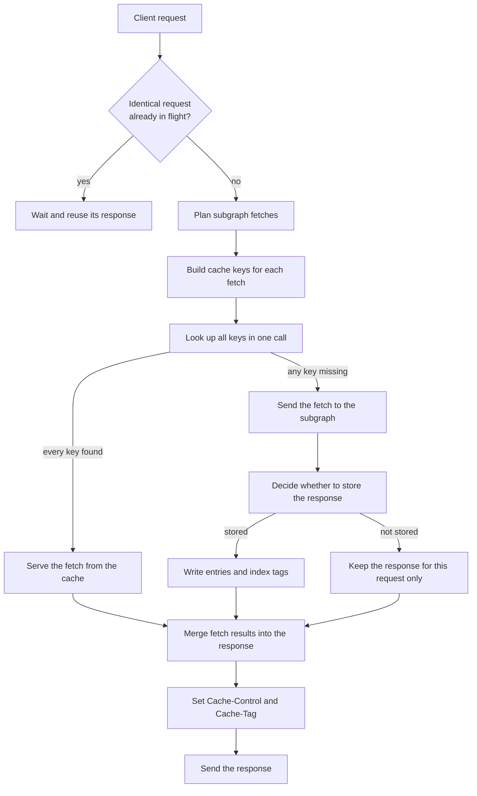

<Danger>
  **Experimental feature.** Response caching is in alpha. The behaviour described here can change between releases.
</Danger>

This page describes what the router does with the cache on every request. It covers how entries are keyed, when a lookup counts as a hit, which subgraph responses are stored and for how long, and what the client is told.

## Request lifecycle

The router plans an operation into subgraph fetches. The cache acts on each fetch separately.



1. **Inbound deduplication.** Identical query requests in flight at the same time share one execution. Only the request that executes reads and writes the cache. The others receive its response. See [Deduplication](#deduplication).
2. **Key building.** The router renders each fetch's subgraph request and derives one key per entry from it. See [Keys](#keys).
3. **Lookup.** All keys of a fetch are read from the store in one call.
4. **Origin.** A fetch that is not a full hit is sent to the subgraph. Identical subgraph requests in flight share one call.
5. **Store decision.** The subgraph's status, body and headers decide whether the response is stored and for how long. See [What is stored](#what-is-stored).
6. **Write.** Stored entries are written before the fetch completes. The write is synchronous: the response waits for it. See [Storage](#storage).
7. **Response headers.** The router turns the lifetimes of the fetches into the client's `Cache-Control`. It also builds the `Cache-Tag` header when that is enabled. See [Client Cache-Control](#client-cache-control).

A cache failure never fails a request. A failed lookup is a miss. A failed write is logged and counted, and the response is sent as usual.

## Which fetches are cached

| Fetch | Cached | Entries |
| --- | --- | --- |
| Root query fetch to a GraphQL subgraph | Yes | One entry for the whole answer |
| Entity fetch (`_entities`) | Yes | One entry per entity |
| Batch entity fetch | Yes | One entry per unique representation |
| Merged entity fetch (`engine.enable_multi_fetch`) | Yes | One entry per entity, per alias |
| Fetches in a mutation or subscription | No | |
| Any fetch of a WebSocket operation | No | |
| Any fetch of a request that uploads files | No | |
| Root fetch to a non-GraphQL data source | No | |
| Introspection | No | |

Fetches inside `@defer` groups are cached like any other fetch of a query.

## Keys

A key is built from SHA-256 digests. Its parts are separated so that bytes cannot move between them.

```
<version>:<entity digest>:<selection digest>[:<private id digest>][+<vary digest>]
```

The store prepends `key_prefix` and `e:`. For example: `cosmo_response_cache:e:2:9f2c…:5feb…`.

### Root query fetches

The entity digest covers the rendered subgraph request:

- the query text the router sends the subgraph
- the variable values
- static headers configured for the subgraph
- the subgraph URL

The key is built from what the subgraph receives, not from the client's document. Two client operations that plan to the same subgraph request share an entry. A change to any variable value, or to the planned query, is a different key.

### Entity fetches

Each entity has its own key:

- **Entity digest.** The representation sent to the subgraph, such as `{"__typename":"Product","sku":"P1"}`.
- **Selection digest.** The rest of the subgraph request: the query text and the variables other than the representations.

A query that needs the same fields of the same entity reuses the entry, wherever the entity appears in the operation. Asking for different fields of the same entity is a different selection, so it is a different entry.

The selection digest covers the whole rendered request. A merged entity fetch puts several aliased `_entities` fields into one request. Its selection digest therefore differs from that of a plain `_entities` request for the same entity and fields. The two do not share entries. See [Limitations](/router/response-cache/limitations#merged-entity-fetches).

### What else is part of the key

- **Forwarded client extensions.** When [`forward-client-extensions`](/router/proxy-capabilities/forward-client-extensions) is on, the extensions sent to the subgraph are part of the selection digest.
- **Undefined variables.** A variable that was omitted is keyed apart from one sent as `null`, because the subgraph receives different requests.
- **Private id.** A `private` response is stored under a key that adds a digest of the request's [`private_id`](/router/response-cache/configuration#private-responses).
- **Vary.** A response with a `Vary` header is stored under a variant key derived from the values of the named headers. See [Varying responses](/router/response-cache/configuration#varying-responses).

Propagated request headers are not part of the key unless the subgraph names them in `Vary`.

The version prefix changes when the key or entry format changes. Entries under an older version are no longer read and expire on their own.

## Lookups

### All or nothing per fetch

A single or batch entity fetch is served from the cache only when every key is found. One missing entity sends the whole fetch to the subgraph, with every representation, including those that were cached. The fetch status is `miss`.

Entities are stored individually, so a later batch made only of cached entities is a full hit.

### Merged entity fetches

A merged fetch is looked up per alias. Warm aliases are left out of the subgraph request and the request is rebuilt for the cold ones. Each alias is still all or nothing. The fetch status is `partial_hit` when some aliases were warm, and `hit` when all were.

When the request for the cold aliases fails, the warm aliases keep their cached data.

### Private and shared entries

A request with a private id looks up the shared key and the private key of every entity in the same call. The private entry wins when both exist.

### Entities that do not exist

An entity the subgraph returns as `null` is not stored. A batch that includes it is never a full hit, so it reaches the subgraph every time.

## What is stored

The decision is made from the subgraph's raw response, before any [response header rules](/router/proxy-capabilities/subgraph-response-header-operations) run. A `cache_control_policy` value or a `set` rule on `Cache-Control` changes what the client receives. It never changes what is stored.

The checks run in this order. The first that applies decides.

| Check | Outcome | Store decision |
| --- | --- | --- |
| The request failed, the body is empty, or the status is 400 or higher | Not stored | `fetch_failed` |
| The status is not 200 or 203 (for example 206 or 304) | Not stored | `uncacheable_status` |
| The body is not valid JSON | Not stored | `invalid_response` |
| The body has a non-empty `errors` array | Not stored | `response_errors` |
| `Cache-Control` has an invalid value | Not stored | `invalid_cache_control` |
| `no-store` | Not stored | `no_store` |
| Unqualified `no-cache` | Not stored | `no_cache` |
| No lifetime and no directive that allows a default | Not stored | `no_directive` |
| The lifetime is zero or less | Not stored | `no_lifetime` |
| `Vary: *`, or more than 100 names in `Vary` | Not stored | `unusable_vary` |
| `private`, and the request has no private id | Not stored | `private_without_id` |
| Nothing to store, such as an entity that does not exist | Not stored | `no_entity` |
| Otherwise | Stored | `stored` |

The store decision is reported per fetch. See [Store decision](/router/response-cache/observability#store-decision).

### Reading Cache-Control

- Directive names are case-insensitive.
- Several `Cache-Control` header lines are read as one, joined by commas.
- When a lifetime directive appears twice, the first one counts.
- An invalid value in a known directive, such as `max-age=abc` or `max-age=-1`, makes the whole header invalid. Nothing is stored, even if `no-store` is also present.
- Qualified `no-cache`, such as `no-cache="Set-Cookie"`, does not prevent storing. Entries hold no response headers, so there is nothing to strip. `no-cache=""` counts as unqualified.
- `private` in any form, including `private="Set-Cookie"`, makes the whole response private.
- If the subgraph request carried an `Authorization` header and the response has none of `public`, `s-maxage` or `must-revalidate`, the response is treated as private. This applies only when `Authorization` is propagated to the subgraph.

### Lifetime

The stored lifetime is the first of these that is present, minus the response's `Age` header:

1. `s-maxage`
2. `max-age`
3. `Expires`, measured against the response's `Date` header, or against the current time if there is no `Date`
4. `fallback_ttl`, but only when the header has one of `public`, `private`, `must-revalidate`, `proxy-revalidate`, `stale-if-error=<seconds>`, `stale-while-revalidate=<seconds>` or a qualified `no-cache`

A response with no `Cache-Control` and no `Expires` is not stored. Neither is one whose `Cache-Control` holds only directives the cache does not use, such as `immutable` or `no-transform`. `fallback_ttl` does not apply to either.

A zero lifetime is not stored and does not fall through to the next source. `max-age=60, s-maxage=0` is not stored. `max-age=0, s-maxage=60` is stored for 60 seconds.

`public` is not required. `max-age=60` on its own is stored for 60 seconds.

The cache does not revalidate entries and does not serve expired entries. `stale-while-revalidate`, `stale-if-error` and `must-revalidate` only make `fallback_ttl` apply.

### Errors and partial data

- A single or batch fetch whose response has any GraphQL error stores nothing, including the entities that resolved.
- In a merged fetch, an error whose path starts at an alias excludes that alias only. An error with no alias in its path excludes every alias.

<Warning>
  The data a subgraph returns is stored before the router checks it against the schema. A wrong type, or `null` in a non-null field, is stored and served from the cache until it expires. This is a known issue.
</Warning>

## Client Cache-Control

The router sets the client's `Cache-Control` only when a `most_restrictive_cache_control` algorithm is configured: [`cache_control_policy`](/router/proxy-capabilities/adjusting-cache-control), or a response header rule with that algorithm. Without one, the response cache adds no `Cache-Control` on a hit or a miss.

With one, the router first replaces each fetch's `Cache-Control` with what the cache knows, and then merges all fetches with the most restrictive algorithm.

**A miss that was stored** reports the subgraph's directives with the lifetimes capped at the stored lifetime, net of `Age`. When the subgraph gave no `max-age` or `s-maxage`:

- a `public` response, or one with `s-maxage`, gets the stored lifetime as `s-maxage`
- any other response gets it as `max-age`

**A hit** reports the time the entry has left:

- `max-age` is the remaining lifetime for browsers. It is never longer than the entry's own remaining lifetime.
- `s-maxage` is the remaining lifetime of the entry, when it differs from `max-age`. A private entry gets no `s-maxage`.
- An entry stored only from `s-maxage`, or from `public` with `fallback_ttl`, is shared-only. Its hit reports `s-maxage` alone, so browsers get no lifetime from it.
- `public` is reported only if every entry served was stored as public. `private` is reported if any came from a private entry.
- A remaining lifetime of zero is reported as `no-cache`.
- No `Age` header is sent. Lifetimes are already net of the time spent in the cache.

**Merging fetches:**

- Any `no-store` makes the response `no-store`.
- `no-cache` replaces all lifetimes.
- The smallest `max-age` and the smallest `s-maxage` win.
- `private` wins if any fetch is private.
- `public` is kept only if every fetch is public. With `apollo_router_compatibility_flags.cache_control_any_public` enabled, `public` is kept if any fetch is public and none is private.
- A fetch without `Cache-Control` or `Expires` is ignored, unless `cache_control_policy.value` stands in for it or `cache_control_policy.missing_no_store` is enabled. See [Client Cache-Control settings](/router/response-cache/configuration#client-cache-control).

Mutations receive `no-cache`. A response with subgraph errors receives `no-store, no-cache, must-revalidate`.

## Deduplication

The cache and [request deduplication](/router/request-deduplication) work together:

- **Inbound deduplication** runs before the cache. Only the leading request looks up and writes. Requests with different private ids never share a flight.
- **Subgraph deduplication** runs after the lookup. Concurrent cold requests for the same fetch each miss, and the subgraph receives one call. Every participant then writes the same entries.
- A request with `Cache-Control: no-cache`, `max-age=0` or `only-if-cached` is not deduplicated with other inbound requests.

## Storage

### Redis

Redis 7.0 or newer is required. Standalone and cluster deployments are supported.

**Entries.** Each entry is a string key `<key_prefix>e:<key>` with the entry's lifetime as its expiry. The value holds:

- a write token
- whether the entry is public, and whether it is shared-only
- the difference between the stored lifetime and the browser lifetime
- the entry's cache tag header values
- the subgraph data: the `data` object of a root fetch, or one entity object

Response headers and the original `Cache-Control` are not stored.

**Tag index.** Each [index tag](/router/response-cache/invalidation#indexes) is a sorted set `<key_prefix>t:<tag>`. Members are entry keys. Scores are their expiry times. Expired members are pruned on write. The set expires five minutes after its last member.

**Reads.** A lookup pipelines `GET` and `PTTL` for each key. The remaining time becomes the entry's reported lifetime.

**Writes.** An untagged entry is one `SET` with its lifetime. A tagged entry takes up to three round trips:

1. The entry is added to each tag set and written with a short lease of up to 10 seconds.
2. Each tag set confirms the entry. If an invalidation ran in the meantime, the entry is deleted.
3. The entry's expiry is extended to its full lifetime.

A writer that dies between the steps leaves an entry that expires with its lease.

**Cluster.** Every script touches one key, and multi-key work is pipelined per key, so no request spans hash slots. Keys use no hash tags.

### Memory

The memory provider keeps entries in a bounded in-process cache with `max_entries` slots. A write can be refused when the cache is full. Tags are indexed in maps that are pruned every 30 seconds.

Each router replica has its own cache. Nothing is shared between replicas, and nothing survives a restart.

## Invalidation

An invalidation request names a [tag](/router/response-cache/invalidation). The store:

1. Records the time of the invalidation on the tag.
2. Walks the tag's index and deletes every entry it lists.
3. Marks entries it walked so that a write racing with the walk is detected.

A write checks the recorded time. An entry whose fetch started at or before the invalidation, allowing one second of clock skew, is deleted instead of kept. A response fetched before the invalidation is therefore not left in the cache by a write that lands after it.

Only indexed entries can be invalidated. With every index turned off, entries leave the cache only when they expire.
