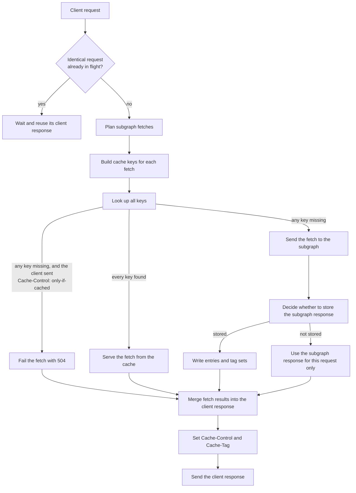

<Warning>
  **Beta feature.** Response caching is a feature that has been released in beta status.
</Warning>

This page explains what the router does with the cache on every request: what it stores, how it finds it again, and what the client is told.

## Terms

- **Client request.** The GraphQL request a client sends the router.
- **Client response.** What the router sends back to the client. It is built from the results of all fetches.
- **Subgraph request.** A request the router sends to a subgraph to resolve part of a client request.
- **Subgraph response.** What a subgraph sends back to the router. The cache stores data from subgraph responses, never client responses.
- **Fetch.** One subgraph request and its subgraph response. One client request can need several fetches.
- **Root fetch.** A fetch for the root `Query` fields of an operation, such as `topProducts`.
- **Entity fetch.** A fetch that asks a subgraph for more fields of objects another subgraph returned. The router sends them in an `_entities` query.
- **Representation.** How the router identifies one object in an entity fetch: its type and key fields, such as `{"__typename":"Product","upc":"1"}`.
- **Entry.** One cached answer. A root fetch is stored as one entry. An entity fetch is stored as one entry per object.
- **Key.** The name an entry is stored under in Redis. Two fetches that send the same subgraph request get the same key, so the second one finds the first one's entry.
- **Hit and miss.** A fetch is a hit when every entry it needs is in the cache, so the subgraph is not called. Otherwise it is a miss.
- **Lifetime.** How long an entry is kept. It comes from the `Cache-Control` or `Expires` header of the subgraph response. Redis deletes the entry when it runs out.
- **Tag.** A label stored next to an entry, such as `subgraph-products`. An [invalidation](/router/response-cache/invalidation) names a tag to delete every entry that carries it.

## An example

A client sends this query. `topProducts`, `name` and `price` come from the `products` subgraph. `reviews` comes from the `reviews` subgraph.

```graphql
query {
  topProducts {
    name
    price
    reviews { body rating }
  }
}
```

The router plans two fetches.

**1. A root fetch to `products`:**

```graphql
{ topProducts { __typename upc name price } }
```

The subgraph answers with two products. The router stores the whole `data` object of that answer as one entry.

**2. An entity fetch to `reviews`**, for the two products the first fetch returned:

```graphql
query($representations: [_Any!]!) {
  _entities(representations: $representations) {
    ... on Product { reviews { body rating } }
  }
}
```

```json
{ "representations": [
  { "__typename": "Product", "upc": "1" },
  { "__typename": "Product", "upc": "2" }
] }
```

The router stores each product's reviews as a separate entry. Redis now holds three entries:

```
cosmo_response_cache:e:2:4b1e…:a03c…   the topProducts answer
cosmo_response_cache:e:2:9f2c…:5feb…   reviews of Product upc 1
cosmo_response_cache:e:2:c71d…:5feb…   reviews of Product upc 2
```

The same query again finds all three entries, and neither subgraph is called.

### Reusing an entry from another query

A different query can reuse an entry when it leads to the same subgraph request. This query asks for one product:

```graphql
query {
  product(upc: "1") {
    name
    reviews { body rating }
  }
}
```

The router plans two fetches again:

1. A root fetch to `products`: `{ product(upc: "1") { __typename upc name } }`. This request differs from `topProducts`, so it is a miss. Its answer is stored as a new entry.
2. An entity fetch to `reviews` for `{"__typename":"Product","upc":"1"}`, asking for `... on Product { reviews { body rating } }`. This is the same request the first query made for product `1`. It finds the entry `9f2c…:5feb…`, and `reviews` is not called.

### When the selection changes

An entity entry is only reused when the same fields are asked for. The fields an entity fetch asks for are its selection set: `reviews { body rating }` in the example.

A query that asks for one field less gets a different request, even for the same product:

```graphql
query {
  product(upc: "1") {
    reviews { body }
  }
}
```

The `reviews` fetch now asks for `... on Product { reviews { body } }`. That is a different selection, so it is a miss, even though the cached entry already holds `body`. The router stores a second entry for product `1` next to the first one. The same happens when an argument changes, such as `reviews(first: 5)` instead of `reviews(first: 10)`. Each distinct selection is cached separately. The cache never answers a request from part of an entry that holds more fields.

How the router turns a request into a key is covered next.


## Keys

A key says which subgraph request an entry answers. The key does not hold the subgraph request itself, which can be large. It holds SHA-256 hashes of its parts, called digests. Two subgraph requests with the same parts produce the same digests, so they get the same key.

A key has two required parts and up to two optional ones:

```
<version>:<entity part>:<selection part>[:<private part>][+<vary part>]
```

Redis stores it with `key_prefix` and `e:` in front, for example `cosmo_response_cache:e:2:9f2c…:5feb…`.

- **Version.** Changes when the router changes how it builds keys or stores entries. Entries under an older version are no longer read and expire on their own.
- **Entity part.** Which object, or which whole request, the entry is about.
- **Selection part.** What was asked about it: the query text and variables of the request.
- **Private part.** Only for `private` subgraph responses. See [Private and shared entries](#private-and-shared-entries).
- **Vary part.** Only for subgraph responses with a `Vary` header. See [Varying responses](#varying-responses).

### Root fetches

A root fetch is one entry, so its key covers the whole request:

- **Entity part:** a digest of the full request the router sends the subgraph. That is the query text, the variable values, the static headers configured for the subgraph and the subgraph URL.
- **Selection part:** a digest of the subgraph's id.

The key comes from what the subgraph receives, not from the client's query. Two client queries that lead to the same subgraph request share an entry. A different variable value, or a different set of fields, is a different key.

### Entity fetches

An entity fetch is one entry per object, so each object gets its own key:

- **Entity part:** a digest of the object's representation, such as `{"__typename":"Product","upc":"1"}`.
- **Selection part:** a digest of the rest of the request: the `_entities` query text, which lists the fields asked for, and the variables other than the representations.

In the example, both products share the selection part `5feb…`, because the router asked for the same fields of both. Their entity parts differ.

A later fetch for the same fields of the same object reuses the entry, wherever the object appears in an operation. Asking for other fields of the same object is a different selection, so it is a different entry.

### Keys in merged entity fetches

With `engine.enable_multi_fetch`, which is on by default, the router can combine entity fetches to the same subgraph that run at the same step of the plan into one request. Each part of that request is an `_entities` field under its own alias, such as `a0: _entities(...)` and `a1: _entities(...)`.

The selection part covers the whole request, aliases included. A merged request therefore has a different selection part from a plain `_entities` request for the same objects and fields. The two do not share entries. See [Limitations](/router/response-cache/limitations#merged-entity-fetches).

### What else is part of the key

- **Client extensions.** Extensions the client sends, other than `persistedQuery`, are forwarded to subgraphs and are part of the selection digest.
- **Undefined variables.** A variable that was omitted is keyed apart from one sent as `null`, because the subgraph receives different requests.
- **Private id.** A `private` subgraph response is stored under a key that adds a digest of the client request's [`private_id`](/router/response-cache/configuration#private-responses).
- **Vary.** A subgraph response with a `Vary` header is stored under a variant key derived from the values of the named headers. See [Varying responses](#varying-responses).

Request headers the router forwards to the subgraph are not part of the key, unless the subgraph names them in `Vary`.

## Request lifecycle

The router plans an operation into subgraph fetches. The cache acts on each fetch separately.



1. **Inbound deduplication.** Identical client requests in flight at the same time share one execution. Only the request that executes reads and writes the cache. The others receive its client response. See [Request Deduplication](/router/request-deduplication#with-the-response-cache).
2. **Key building.** The router renders each fetch's subgraph request and derives one key per entry from it. See [Keys](#keys).
3. **Lookup.** All keys of a fetch are read from the store in one call, or two when the entry varies. See [Varying responses](#varying-responses).
4. **Origin.** A fetch that is not a full hit is sent to the subgraph. With [`only-if-cached`](#request-directives), it fails instead. Identical subgraph requests in flight share one call.
5. **Store decision.** The status, body and headers of the subgraph response decide whether it is stored and for how long. See [What is stored](#what-is-stored).
6. **Write.** Stored entries are written before the fetch completes. The write is synchronous: the client response waits for it. See [Storage](#storage).
7. **Client response headers.** The router turns the lifetimes of the fetches into the `Cache-Control` of the client response. It also builds the `Cache-Tag` header when that is enabled. See [Client Cache-Control](#cache-control-of-cached-fetches).

A cache failure does not fail a client request, except one sent with `only-if-cached`. A failed lookup is a miss. A failed write is logged and counted, and the client response is sent as usual.

## Which fetches are cached

| Fetch | Cached | Entries |
| --- | --- | --- |
| Root query fetch to a GraphQL subgraph | Yes | One entry for the whole answer |
| Entity fetch (`_entities`) | Yes | One entry per entity |
| Batch entity fetch | Yes | One entry per unique representation |
| Merged entity fetch (`engine.enable_multi_fetch`, on by default) | Yes | One entry per entity, per alias |
| Fetches in a mutation or subscription | No | |
| Any fetch of a WebSocket operation | No | |
| Any fetch of a client request that uploads files | No | |
| Any fetch to a gRPC subgraph or router plugin | No, not supported. See [Limitations](/router/response-cache/limitations#grpc-subgraphs-and-plugins-are-not-supported). | |
| Introspection | No | |

Fetches inside `@defer` groups are cached like any other fetch of a query. The client response to a `@defer` query always carries `Cache-Control: no-cache`.

## Lookups

A lookup reads every key a fetch needs from Redis in one call.

### All or nothing per fetch

An entity fetch is served from the cache only when every one of its objects is found. If one object is missing, the router sends the whole fetch to the subgraph, including the objects that were cached. The fetch counts as a `miss`.

In the example, if the reviews of product `1` are cached but those of product `2` are not, the `reviews` subgraph is asked for both.

Each object is still stored on its own. A later fetch made only of cached objects is a hit.

### Merged entity fetches

A [merged fetch](#keys-in-merged-entity-fetches) is looked up per alias. An alias whose objects are all cached is answered from the cache and left out of the request. The router rebuilds the request with only the other aliases and sends that. Each alias is still all or nothing. The fetch counts as a `partial_hit` when some aliases came from the cache, and a `hit` when all did.

When the rebuilt request fails, the aliases answered from the cache keep their data. Fetches that depend on the merged fetch are still skipped, and their fields are `null` without an error. See [Limitations](/router/response-cache/limitations#merged-entity-fetches).

### Private and shared entries

Most entries are shared: every fetch with the same key gets the same answer. A `private` subgraph response is stored under a key with an extra part for the user or tenant it belongs to, called the [private id](/router/response-cache/configuration#private-responses).

A client request with a private id looks up both keys of every object in one call. The private entry wins when both exist.

- The private part of the key is a SHA-256 digest of the id. Raw ids are never written to Redis.
- A client request without a private id does not store or read private entries. The subgraph is asked every time.
- Invalidation by subgraph, type or tag also removes private entries.
- A [`set` response header rule](/router/proxy-capabilities/subgraph-response-header-operations) on `Cache-Control` can replace `private` in the client response. It does not change how the entry is stored.

### Objects that do not exist

An object the subgraph returns as `null` is not stored, so a fetch that includes it is never a hit. See [Limitations](/router/response-cache/limitations#entities-that-do-not-exist-are-not-cached).

## Varying responses

A subgraph whose answer depends on a request header, such as `Accept-Language`, names it in a `Vary` response header. The router keeps one entry per combination of values it sent.

- The first subgraph response stores the names from `Vary` as a record at the entry's key, and the body under a variant key.
- A later lookup reads the record, digests the values of those headers in the current subgraph request, and reads the variant.
- Values are taken from the request the router builds, after header propagation. A named header the router does not set counts as empty.
- `Vary: *` is not stored. Neither is a `Vary` with more than 100 names, nor a response whose varied header was changed after the router built the request, for example by a custom module. `Accept`, `Accept-Encoding` and `Content-Type` are not checked. The entry is keyed by the value the router built, not the one sent. A module that changes them based on other input can cause wrong hits.
- A header with a value per caller, such as `Cookie` or `Authorization`, yields one entry per caller. Such entries are rarely reused. Use `private` instead.
- When the subgraph changes the names it varies on, the new set is added to the record. A record keeps up to 8 sets, newest first. An older variant stays reachable while both it and the record live. The record takes the newest response's lifetime, and a response without `Vary` replaces it.

## What is stored

The decision is made from the raw subgraph response, before any [response header rules](/router/proxy-capabilities/subgraph-response-header-operations) run. A `cache_control_policy` value or a `set` rule on `Cache-Control` changes the client response. It never changes what is stored.

The checks run in this order. The first that applies decides. In a merged entity fetch, headers are checked once and the rest per alias. It reports `stored` when any alias was stored.

| Check | Outcome | Store decision |
| --- | --- | --- |
| The subgraph request failed, the body is empty, or the status is 400 or higher | Not stored | `fetch_failed` |
| The status is not 200 or 203 (for example 206 or 304) | Not stored | `uncacheable_status` |
| The body is not valid JSON | Not stored | `invalid_response` |
| The body has a non-empty `errors` array | Not stored | `response_errors` |
| `Cache-Control` has an invalid value | Not stored | `invalid_cache_control` |
| `no-store` | Not stored | `no_store` |
| Unqualified `no-cache` | Not stored | `no_cache` |
| No lifetime and no directive that allows a default | Not stored | `no_directive` |
| The lifetime is zero or less | Not stored | `no_lifetime` |
| `Vary` cannot be used, such as `Vary: *`. See [Varying responses](#varying-responses). | Not stored | `unusable_vary` |
| `private`, and the client request has no private id | Not stored | `private_without_id` |
| `_entities` is missing or has the wrong length | Not stored | `invalid_response` |
| Nothing to store, such as an entity that does not exist | Not stored | `no_entity` |
| Otherwise | Stored | `stored` |

The store decision is reported per fetch. See [Store decision](/router/response-cache/observability#store-decision).

### How the subgraph's Cache-Control is read

These rules apply to the `Cache-Control` header of the subgraph response. The `Cache-Control` a client sends in its request is covered under [Request directives](#request-directives).

- Directive names are case-insensitive.
- Several `Cache-Control` header lines are read as one, joined by commas.
- When a lifetime directive appears twice, the first one counts. The second is ignored, even if invalid.
- An invalid value in a known directive, such as `max-age=abc` or `max-age=-1`, makes the whole header invalid. Nothing is stored, even if `no-store` is also present.
- Qualified `no-cache`, such as `no-cache="Set-Cookie"`, does not prevent storing. Entries hold no response headers, so there is nothing to strip. `no-cache=""` counts as unqualified.
- `private` in any form, including `private="Set-Cookie"`, makes the whole subgraph response private.
- A subgraph request that carried `Authorization` can make the subgraph response private. See [Authorization](#authorization).

### Authorization

A subgraph request that carries an `Authorization` header produces a private response unless the response says `public`, `s-maxage` or `must-revalidate`. Without a `private_id`, such a response is not stored.

This applies only when `Authorization` is propagated to the subgraph. A subgraph that serves the same data to every authenticated caller should say `public`.

- The miss response does not carry `private` from this rule. Its hits do. To keep such responses out of a CDN:
  - Send `private` from the subgraph.
  - Configure a [cache control policy](/router/proxy-capabilities/adjusting-cache-control).
  - Make sure no `set` rule replaces `private`.
- Only `Authorization` triggers the rule. Other credentials, such as `Cookie` or a custom header, do not make a response private.

### Lifetime

The stored lifetime is the first of these that is present in the subgraph response, minus its `Age` header:

1. `s-maxage`
2. `max-age`
3. `Expires`, measured against the `Date` header, or against the current time if there is no `Date`
4. `fallback_ttl`, but only when the header has one of `public`, `private`, `must-revalidate`, `proxy-revalidate`, `stale-if-error=<seconds>`, `stale-while-revalidate=<seconds>` or a qualified `no-cache`

A subgraph response with no `Cache-Control` and no `Expires` is not stored. Neither is one whose `Cache-Control` holds only directives the cache does not use, such as `immutable` or `no-transform`. `fallback_ttl` does not apply to either.

A zero lifetime is not stored and does not fall through to the next source. `max-age=60, s-maxage=0` is not stored. `max-age=0, s-maxage=60` is stored for 60 seconds.

`public` is not required. `max-age=60` on its own is stored for 60 seconds.

The cache does not revalidate entries and does not serve expired entries. `stale-while-revalidate`, `stale-if-error` and `must-revalidate` only make `fallback_ttl` apply.

### Errors and partial data

- A single or batch fetch whose subgraph response has any GraphQL error stores nothing, including the entities that resolved.
- In a merged fetch, an error whose path starts at an alias excludes that alias only. An error with no alias in its path excludes every alias.

Data is stored before it is checked against the schema. See [Limitations](/router/response-cache/limitations#subgraph-data-is-not-validated-before-storing).

## Cache-Control of cached fetches

The `Cache-Control` of the client response is built by the [cache control policy](/router/proxy-capabilities/adjusting-cache-control), which merges the `Cache-Control` of every fetch. The cache changes what a cached fetch contributes to that merge. Without a policy, the cache adds no `Cache-Control` to the client response.

**A fetch that missed and was stored** reports the subgraph's directives with the lifetimes capped at the stored lifetime, minus the `Age` header of the subgraph response. When the subgraph gave no `max-age` and no `Expires`:

- a non-private subgraph response that is `public` or has `s-maxage` gets the stored lifetime as `s-maxage`
- any other gets it as `max-age`

**A hit** reports the time the entry has left:

- `max-age` is the remaining lifetime for browsers. It is never longer than the entry's own remaining lifetime.
- `s-maxage` is the remaining lifetime of the entry, when it differs from `max-age`. A private entry gets no `s-maxage`.
- An entry stored only from `s-maxage`, or from `public` with `fallback_ttl`, is shared-only: its lifetime is meant for shared caches such as a CDN, not for browsers. Its hit reports `s-maxage` alone.
- `public` is reported only if every entry served was stored as public. `private` is reported if any came from a private entry.
- A remaining lifetime of zero is reported as `no-cache`.
- No `Age` header is sent. The lifetimes already exclude the time spent in the cache.

## Request directives

A client can control the cache for its own request with the `Cache-Control` request header.

| Request directive | Effect |
| --- | --- |
| `no-cache`, or `max-age=0` | Not answered from the cache. Every fetch goes to its subgraph and the responses are stored, so the entries are refreshed. |
| `no-store` | Nothing is stored. Existing entries can still answer the request. |
| `no-cache, no-store` | The cache is neither read nor written. |
| `only-if-cached` | Every fetch must be answered from the cache. Otherwise the request fails with status `504`. Batched and `@defer` requests get fetch errors instead of `504`. Combined with `no-cache` or `max-age=0`, it always fails. Fetches to subgraphs the cache is off for fail too, and so do mutations, which then do not run. Introspection is exempt. |

`max-age` greater than zero, `min-fresh` and `max-stale` are ignored. So is the `Pragma` header. A `Cache-Control` request header that cannot be parsed is ignored.

Requests with `no-cache`, `max-age=0` or `only-if-cached` skip [inbound deduplication](/router/request-deduplication#with-the-response-cache).

<Warning>
  Any client can send these directives. They cannot be turned off. A client that sends `no-cache` on every request bypasses the cache, and its subgraphs see all of its traffic.
</Warning>

## Storage

### Redis

The cache keeps two kinds of Redis key:

| Redis key | Type | Holds |
| --- | --- | --- |
| `<key_prefix>e:<key>` | String | One entry |
| `<key_prefix>t:<tag>` | Sorted set | The keys of every entry that carries the tag |

**Entries.** Each entry is a string with the entry's lifetime as its Redis expiry, so Redis deletes it when the lifetime ends. The value holds:

- the subgraph data: the `data` object of a root fetch, or one object of an entity fetch
- the entry's tags, so a hit can rebuild the [cache tag header](/router/response-cache/invalidation#cdn-purging)
- whether the entry is public, and whether it is shared-only
- how much shorter the browser lifetime is than the stored lifetime
- a token naming the write that stored it, so a writer only ever changes its own entry
- the time the entry expires

The headers of the subgraph response, including its `Cache-Control`, are not stored. For a subgraph response with a `Vary` header, the entry at the key holds the list of header names instead, and the data sits under a second key that adds the vary part.

**Tag sets.** An [invalidation](/router/response-cache/invalidation#how-an-invalidation-runs) needs to find every entry with a given tag. Each tag therefore has a sorted set listing the keys of its entries. A set member's score is the time that entry expires. Members more than five minutes past expiry are removed on the next write. The set itself expires five minutes after its last member.

**Reads.** On a single Redis node, a lookup reads every key with one `MGET`. On Redis Cluster, it sends a `GET` for each key in one batch. Each entry carries the time it expires, and the time it has left becomes the lifetime reported to the client. That time is taken with the reading router's clock, so clock skew between routers shifts the reported lifetime by the same amount. Redis still deletes the entry on its own clock. Entries written by an earlier router version are still read, with an extra `PTTL` for each.

**Writes.** An entry without tags is one `SET` with its lifetime. An entry with tags takes up to three round trips, so that an invalidation running at the same time cannot be missed:

1. The entry is added to each tag set. It is written with a short lifetime of up to 10 seconds, called its lease.
2. Each tag set is checked again. If an invalidation ran in the meantime, the entry is deleted.
3. The entry's lifetime is extended to its full value, or the entry is deleted if a tag was invalidated since step 1.

An entry with a lifetime of 10 seconds or less is written with its full lifetime in step 1 and skips the later checks. A router that stops between the steps leaves an entry that expires with its lease.

A write that times out is counted as failed, but can still land. An untagged entry then lives its full lifetime. A tagged entry is removed, kept for its lease, or kept for its full lifetime, depending on the step that timed out.

**Cluster.** Redis Cluster spreads keys over nodes by hash slot, and one command cannot touch keys in different slots. Every command the cache sends to a cluster touches one key, so it works with any key layout. `MGET` is only sent to a single node. Keys use no hash tags.
